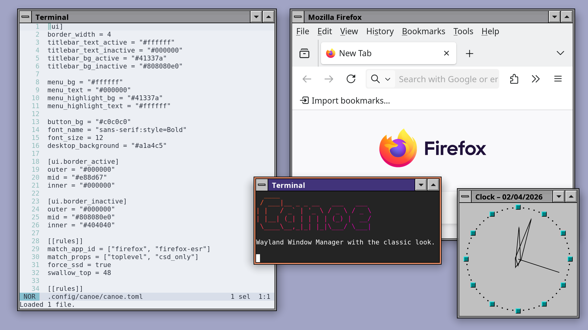

# Canoe 🛶 - Stacking Wayland Compositor



A stacking Wayland compositor and window manager, written in Rust on top of
[Smithay](https://github.com/Smithay/smithay).

> **Experimental branch.** Canoe started out as a window manager for the
> River compositor. This branch runs the same window manager inside its own
> compositor instead. See [Status of the standalone
> compositor](#status-of-the-standalone-compositor) for what is missing.

## Features

- Stacking window management
- Server-side decorations with classic window borders & titlebars, for every
  app that can be asked to leave its decorations to the window manager (apps
  that only draw their own, like libadwaita's, keep them)
- Titlebar/edge window movement and resizing (Super+Drag anywhere)
- Multihead support (focus/send windows across outputs, windows follow
  output layout and resolution changes, and move off unplugged outputs)
- New windows open fully on screen; apps that ask for more room than the
  screen has are shrunk to fit, as far as their minimum size allows
- Window switcher (keyboard cycle + desktop right-click menu)
- Window focus follows click
- Minimized windows shown as icons on the desktop (can be disabled)
- Optional forcing server-side decorations via per-window rules
- Optional "swallowing" of client-side decoration via per-window rules
- Screen sharing of whole screens or individual windows, picked by clicking them
- Shaped text with font fallback and color emoji in titles, menus and icon labels

## Installation

```bash
cargo install canoe
```

## Running

From a text console (VT), with seatd or systemd-logind managing the seat:

```bash
canoe
```

Inside a running Wayland or X11 session, `canoe` opens a window instead
(`--backend winit`; built with the default `winit` feature), which is handy
for trying it out. `--backend headless` runs without any monitor, for
automated tests (see `tools/e2e`).

X11 programs run through Xwayland, which Canoe starts if it is installed
(programs it launches find it through `DISPLAY`); `--no-xwayland` turns that
off. An X11 window's app id, as window rules match it, is its `WM_CLASS`
class (e.g. `XTerm`).

To start Canoe from a display manager (GDM, SDDM, LightDM, greetd with
tuigreet, …), install the session file and the portal configuration:

```bash
sudo install -Dm644 contrib/canoe.desktop /usr/share/wayland-sessions/canoe.desktop
sudo install -Dm644 contrib/canoe-portals.conf /usr/share/xdg-desktop-portal/canoe-portals.conf
```

The session sets `XDG_CURRENT_DESKTOP` to `canoe`, and `canoe-portals.conf`
picks the portal backends for that desktop (see [Screen
Sharing](#screen-sharing)).

The display manager looks up `canoe` in its own `PATH`, which does not include
your home directory, so changes in `~/.profile` or `~/.config/environment.d/`
don't help. If `canoe` lives in your home directory (e.g. after
`cargo install`), link it somewhere on the system `PATH`:

```bash
sudo ln -s ~/.cargo/bin/canoe /usr/local/bin/
```

## Building From Source

```bash
cargo build --release
```


## Keyboard Shortcuts

| Shortcut | Action |
|----------|--------|
| `Super+Shift+Return` | Open terminal (foot) |
| `Super+Space` | Open application launcher (fuzzel) |
| `Super+l` | Lock the screen (swaylock) |
| `Super+w` | Close focused window |
| `Super+Tab` | Focus next window |
| `Super+Shift+Tab` | Focus previous window |
| ``Super+` `` | Focus next window of the same application |
| `Super+Enter` | Toggle fullscreen |
| `Super+Down` | Unfullscreen/unmaximize, otherwise minimize focused window |
| `Super+Up` | Maximize focused window |
| `Super+h` | Minimize focused window |
| `Super+m` | Minimize focused window |
| `Super+d` | Minimize all windows; press again to bring them back |
| `Super+Left` | Snap focused window to left half; restore if snapped right |
| `Super+Right` | Snap focused window to right half; restore if snapped left |
| `Super+Alt+Left` | Send focused window to previous output |
| `Super+Alt+Right` | Send focused window to next output |
| `Super+Alt+Up` | Send focused window to previous output |
| `Super+Alt+Down` | Send focused window to next output |

## Mouse Actions

| Action | Result |
|--------|--------|
| Click on window | Focus window |
| Drag titlebar | Move window |
| Drag window edges | Resize window |
| `Super+Left Drag` | Move window (anywhere) |
| `Super+Right Drag` | Resize window (anywhere) |

## Multiple Outputs

Windows belong to the output they were opened or last moved on, and keep
their place on it when the output layout changes:

- When an output moves, e.g. because one next to it was unplugged or
  rearranged with a tool like `wdisplays` or `kanshi`, its windows move with it.
- When an output is unplugged, its windows move to the output you are working
  on, or to the nearest remaining one if you were working on the unplugged
  output. They keep their relative position and are shrunk only if they don't
  fit. Snapped and maximized windows are snapped the same way on their new
  output, and fullscreen windows go back to their windowed size.
- When an output's resolution or scale changes, snapped and maximized windows
  follow the new size. Windows that fit on the output before but are now cut
  off are moved back onto it, and shrunk if needed and their minimum size
  allows. Windows you placed partly off-screen yourself stay where they are.

Sending a window to another output with `Super+Alt+Arrow` works the same way.

### Remembered layouts and the primary output

Canoe remembers how the outputs are set up for each combination of connected
monitors, and sets them up that way again when that combination comes back,
e.g. when you dock your laptop. Set them up once with any tool that speaks
wlr-output-management, such as `wdisplays` or `wlr-randr`: which outputs are
on, their modes, positions, scales and transforms are saved as they are
applied. kanshi isn't needed, though it still works: whatever it applies is
remembered just the same.

Monitors are recognized by make, model and serial number, so a layout follows
a monitor to another port. Two identical monitors without serial numbers are
told apart by their ports.

On a laptop the lid counts too: the laptop's panel with an external monitor
and the lid open is another combination than with the lid closed, and each
has its own layout. Without a layout of its own, closing the lid turns the
panel off (unless it is the only output) and opening it turns the panel back
on, left of the other outputs. To keep the panel on with the lid closed, turn
it on again while the lid is closed; that is remembered like any other change.

Each combination can have a primary output: the one new windows open on when
monitors come or go, and the one launchers and other panels without an output
of their own appear on. Choosing it moves the focus there. Canoe starts with
the pointer in the middle of the primary output (or, without one, of the
output at the top left). Output tools choose
it through Canoe's experimental `xx-primary-output-v1` protocol; for now
`tools/wlinput` has a small client for it:

```sh
wlprimary              # print the primary output
wlprimary set DP-1     # make DP-1 primary for the monitors connected now
wlprimary unset
```

The layouts are kept in `~/.local/state/canoe/outputs.toml` (under
`$XDG_STATE_HOME` if set). `remember_outputs = false` in the configuration
file turns all of this off; new outputs are then lined up left to right.

## Screen Sharing

Apps share the screen through the screencast portal. For Canoe that portal is
[xdg-desktop-portal-wlr](https://github.com/emersion/xdg-desktop-portal-wlr)
(0.8 or newer for sharing single windows). It asks a *chooser* program what to
share, and Canoe is one: when an app wants to share, Canoe dims all screens and
highlights the window or screen under the pointer. Click to share it, or use
`Tab`/arrow keys and `Return`; `Esc` or a right click cancels.

Chrome asks twice per share: once for the preview in its own dialog, and again
when you confirm there. A request within 10 seconds of your pick that offers the
same window or screen gets the same answer without asking, once.

1. Install `xdg-desktop-portal-wlr` (e.g. `apt install xdg-desktop-portal-wlr`).

2. Route screen sharing to it with [`contrib/canoe-portals.conf`](contrib/canoe-portals.conf),
   installed as `/usr/share/xdg-desktop-portal/canoe-portals.conf` or
   `~/.config/xdg-desktop-portal/canoe-portals.conf`. It contains:

   ```ini
   [preferred]
   default=gtk
   org.freedesktop.impl.portal.ScreenCast=wlr
   org.freedesktop.impl.portal.Screenshot=wlr
   ```

3. Make Canoe its chooser in `~/.config/xdg-desktop-portal-wlr/config`:

   ```ini
   [screencast]
   chooser_type=dmenu
   chooser_cmd=canoe --share-picker
   ```

   The portal runs as a systemd user service, whose `PATH` may not include
   `~/.cargo/bin`; give the full path to `canoe` if it lives there.

4. Restart the portals (or log in again):
   `systemctl --user restart xdg-desktop-portal xdg-desktop-portal-wlr`.

The portal needs to know which Wayland display to capture. On startup Canoe
exports `WAYLAND_DISPLAY`, `XDG_CURRENT_DESKTOP` (defaulting to `canoe`) and
`XDG_SESSION_TYPE` (`wayland`) to the systemd user manager and D-Bus activation
environment, using the same values as the programs it launches (see
[Environment variables](#environment-variables)). `XCURSOR_THEME` and `XCURSOR_SIZE` are
exported too if set, so services started this way use the same cursors. If you
manage the session environment yourself (or run Canoe nested), turn that off:

```toml
update_activation_environment = false
```

The headless backend never exports anything, so test sessions don't redirect
the portals of the session you're working in.

On River, wlroots 0.20.2 and earlier could show a black share when an app
captured a window that was already being captured (Chrome does this,
previewing the window while it asks to share it). Canoe's own compositor
renders every capture afresh and doesn't have this problem; the workaround
from the River days (briefly flagging the picked window as resizing and tiled
so it repaints) still runs, and is harmless.

## Screenshots

Tools that capture through the wlroots screencopy or ext-image-copy-capture
protocols work as they are: grim (with slurp to pick an area),
xfce4-screenshooter (full screen and region; it has no window mode on
Wayland) and cosmic-screenshot.

Tools that use the screenshot portal need it set up as in
[Screen Sharing](#screen-sharing). xdg-desktop-portal-wlr takes full-screen
shots itself, but answers every *interactive* request by letting you drag a
region with slurp (it runs `grim -g "$(slurp)"`, so both must be installed),
whatever the app asked for. ksnip, for example, captures the full screen
directly, while its monitor, window and region modes all become that region
selection.

Some tools only work on the compositor they were made for. Canoe can pretend
to be sway or KWin for them:

```toml
emulate_sway = true   # shotman, grimshot
emulate_kwin = true   # Spectacle
```

- `emulate_sway` answers sway's IPC on the socket `SWAYSOCK` names, which is set
  for the programs Canoe launches (if you turn it on with a reload, for those
  launched after). It tells where outputs and windows are and which one is
  focused, so shotman can capture the focused window and grimshot its
  `active`, `window` and `output` targets. Commands and events aren't supported:
  `swaymsg` commands and bars' sway modules still don't work.
- `emulate_kwin` takes the names `org.kde.KWin` and `org.kde.KWin.ScreenShot2` on
  the session bus and offers KWin's screenshot interface. Spectacle then works
  in all its modes: full screen, current monitor, active window, rectangular
  region, and window under the cursor, which you pick with Canoe's picker
  (click a window; `Esc` or a right click cancels). KDE programs may then take
  Canoe for KWin and try other KWin interfaces, which fail.

## Configuration

Canoe reads `~/.config/canoe/canoe.toml`. After editing it, send `SIGHUP` to
re-read it without restarting (e.g. `pkill -HUP canoe`); this refreshes the
theme, desktop, window rules, and key bindings. Pass `--no-config` to ignore the
file and use the built-in defaults (reloads keep honoring this).

[`contrib/canoe.toml`](contrib/canoe.toml) lists every setting with its
default and is a good starting point for your own configuration;
[`contrib/themes/`](contrib/themes) has an example theme.

The main modifier defaults to `super`, but you can change it:

```toml
main_modifier = "alt"
```

The launcher defaults to `fuzzel`. You can override it with a command or argv:

```toml
launcher_cmd = "fuzzel"
# Or with arguments:
launcher_cmd = ["fuzzel", "--dmenu"]
```

The terminal defaults to `foot`. Override it the same way:

```toml
terminal_cmd = "alacritty"
# Or with arguments:
terminal_cmd = ["wezterm", "start"]
```

The screen locker defaults to `swaylock`. Override it the same way:

```toml
lock_cmd = "swaylock"
# Or with arguments:
lock_cmd = ["swaylock", "-f", "-c", "000000"]
```

### Startup commands

`startup_cmds` lists programs Canoe launches when it starts, e.g. to set a
wallpaper or start a notification daemon. Each entry is a
program name or an argv array, like `launcher_cmd`. A plain string is not run
through a shell, so pass arguments as an array (`"swaybg -i wall.png"` would
look for a program with that literal name).

```toml
startup_cmds = [
    "mako",
    ["swaybg", "-i", "/home/me/wallpaper.png", "-m", "fill"],
]

[ui]
desktop_background = "transparent"  # let the wallpaper show, see below
```

The commands are launched in order, but Canoe does not wait for one to finish
before starting the next. They start once Canoe has set up the desktop on every
output. They run only at startup: a `SIGHUP` reload does not run them again, so
changes take effect the next time Canoe starts.

When a program like `swaybg` draws your wallpaper, set `desktop_background =
"transparent"`, as above; see [Desktop and wallpapers](#desktop-and-wallpapers)
for why.

### Environment variables

Variables under the `[env]` table are set for every program Canoe launches:
startup commands, the launcher, terminal, screen locker, and hotkey commands.
They do not change Canoe's own environment. Changes apply to programs launched
after the next `SIGHUP` reload. Values for `WAYLAND_DISPLAY` and
`XDG_CURRENT_DESKTOP` are also what Canoe exports for the screen-sharing portal
on startup (see [Screen Sharing](#screen-sharing)).

```toml
[env]
MOZ_ENABLE_WAYLAND = "1"
QT_QPA_PLATFORM = "wayland"
```

All values must be strings: `MOZ_ENABLE_WAYLAND = 1` is a type error, which
makes Canoe ignore the whole configuration file.

### Cursor theme

`xcursor_theme` and `xcursor_size` set the XCursor theme and cursor size (in
logical pixels) for cursors that Canoe draws: on the desktop, titlebars and
borders, and while moving or resizing windows. Canoe also sets
`XCURSOR_THEME` and `XCURSOR_SIZE` for the programs it launches, so their
cursors match.

```toml
xcursor_theme = "Adwaita"
xcursor_size = 32
```

The theme and size are looked up separately: first in `canoe.toml`, then
`XCURSOR_THEME`/`XCURSOR_SIZE` in the [`[env]`](#environment-variables) table,
then Canoe's own environment. If none of them sets a value, Canoe uses the
`default` theme at size 24, and launched programs get no `XCURSOR_*` variable,
so they pick their own default.

A `SIGHUP` reload changes the cursors Canoe draws right away. Programs that are
already running keep the theme they started with.

GTK apps usually ignore these variables and take their cursor theme from
GNOME's settings instead (`gsettings set org.gnome.desktop.interface
cursor-theme Adwaita`, and `cursor-size` for the size).

### X11 programs

On scaled outputs, X11 programs draw at the outputs' scale, rounded up to a
whole number (the largest scale if outputs differ, shrunk on the others), so
they are as crisp as Wayland programs. Canoe tells them how much bigger to
draw through the X resources `Xft.dpi`, `Xcursor.theme` and `Xcursor.size`
(Xft fonts, Qt, xterm) and XSETTINGS (`Gdk/WindowScalingFactor` for GTK,
`Xft/DPI` for others). Programs that ignore both come out small. Turn it off
to have X11 programs drawn at scale 1 and stretched, blurry but at their
usual size:

```toml
xwayland_hidpi = false
```

The scale follows outputs coming, going and changing scale, and `SIGHUP`
reloads. GTK programs follow along while they run; most others read the X
resources only when they start, so programs already running keep drawing at
their old size, while canoe keeps their windows' size on screen. If
`XCURSOR_SIZE` is set for launched programs (see above), it takes precedence
over `Xcursor.size`, so their X11 cursors come out small on scaled outputs.

### Hotkeys

Bind arbitrary key chords to commands under the `[hotkeys]` table. Each key is a
`+`-separated chord (modifiers first, the key last); each value is the command to
spawn, given as a string that is split on whitespace into program + arguments:

```toml
[hotkeys]
"Super+I"       = "control-panel"
"Super+P"       = "control-panel -m display"
"Super+Shift+T" = "foot"
```

If an argument itself contains spaces, use the array form instead, which is
taken verbatim as the argv (no splitting):

```toml
"Super+E" = ["sh", "-c", "notify-send 'hi there' && foot"]
```

Recognized modifiers are `super` (aliases `logo`/`win`/`mod4`), `alt` (`mod1`),
`ctrl`/`control`, `shift`, `mod3`, and `mod5`. Keys are named by their XKB keysym
(`i`, `Return`, `space`, `F5`, `XF86AudioRaiseVolume`, …), matched
case-insensitively — so `Super+I` triggers on the physical `I` key; add `Shift`
explicitly if you mean the shifted chord. A hotkey naming the same chord as a
built-in shortcut overrides it.

Edits to `[hotkeys]` (and `main_modifier`) take effect on the next `SIGHUP`
reload — no restart needed; canoe rebinds every seat's shortcuts.

### UI Settings

UI options live under the `[ui]` table and let you tune borders, titlebars, and menu colors.
Colors accept `#RGB`, `#RRGGBB`, `#RRGGBBAA`, or `transparent`.

Sizes (borders, shadows, fonts) are given in logical pixels. They scale with the
display's (fractional) scale and are drawn crisply at its native resolution.

```toml
[ui]
border_width = 10
border_active = { outer = "#FFD000", mid = "#000000", inner = "#FFD000" }
border_inactive = { outer = "#000000", mid = "#000000", inner = "#000000" }
titlebar_text_active = "#000000"
titlebar_text_inactive = "#808080"
titlebar_bg_active = "#FFD000"
titlebar_bg_inactive = "#202020"
menu_bg = "#000000"
menu_text = "#FFFFFF"
menu_highlight_bg = "#FFD000"
menu_highlight_text = "#000000"
button_bg = "#202020"
button_highlight = "#FFD000"
button_shadow = "#000000"
shadows_enabled = true          # master toggle; when false menus fall back to a flat L-shape
shadows_active_size = 25        # soft shadow size for the focused window (and menus)
shadows_inactive_size = 12      # soft shadow size for non-focused windows
shadows_color = "#00000033"     # shadow color used for the soft drop shadow
font_name = "Sans"
font_size = 15.0
desktop_background = "#101010"
desktop_menu = true             # set to false to let clicks on the empty desktop reach a wallpaper client
icons_enabled = true            # set to false to hide minimized-window icons on the desktop
icons_font_name = "Sans"        # optional; defaults to a regular-weight variant of font_name
icons_font_size = 12.0          # optional; defaults to font_size * 0.80
icons_text = "#FFFFFF"          # optional; defaults to menu_text
icons_highlight_bg = "#FFD000"  # optional; defaults to menu_highlight_bg
icons_highlight_text = "#000000" # optional; defaults to menu_highlight_text
animations_enabled = true       # set to false to make windows jump into place
animations_duration = 150       # milliseconds; 0 also turns animations off
```

When a window is maximized, snapped to a half of the screen or restored, it
glides and stretches into its new place instead of jumping there. The
client's content stretches along, while the frame's borders, the titlebar's
height and the shadow's corners keep their size. A minimized window shrinks
into its desktop icon and fades out, and grows back out of it when it is
brought back.

#### Desktop and wallpapers

Canoe draws the desktop on two layer-shell surfaces per output:

- `desktop_background` is a solid fill on the `background` layer.
- Minimized-window icons are drawn on a transparent surface on the `bottom`
  layer, above any wallpaper.

A minimized window's icon is the first of these that exists:

1. `~/.config/canoe/icons/<app-id>.svg` or `.png`, your own choice;
2. the icon the program set for the window (xdg-toplevel-icon), drawn from
   the images it sent or, if it sent none, looked up by name in the hicolor
   theme. Programs may change it at any time, and the desktop follows;
3. the `Icon=` of the program's desktop entry, `<app-id>.desktop`;
4. the first letter of the window's title.

**If you use a separate program to show a background image** (`swaybg`,
`shaderbg`, `wpaperd`, …), set:

```toml
[ui]
desktop_background = "transparent"
```

Wallpaper programs draw on the `background` layer too. Canoe always draws
its fill below them, so a wallpaper is never hidden by it, but drawing a fill
nobody sees is wasted work.

By default the icon surface takes pointer input across the whole output,
except where bars and panels reserve space (their exclusive zones), so clicks
on them always reach them: right-clicking the empty desktop opens the window
menu, and left-clicking it unfocuses the current window and deselects icons.
With `desktop_menu = false`, only the icons take input and every other click
goes to whatever is below, e.g. an interactive wallpaper like `shaderbg`.
Canoe then no longer sees clicks on the empty desktop, so they neither open
the menu nor unfocus windows.

### Rule Matching

Rules live under `[[rules]]` in `canoe.toml`. App ID matching uses OR across the
app-id fields, and property matching uses AND across the listed properties.

```toml
[[rules]]
match_app_id = ["foot", "kitty"]   # exact match, any value matches
match_app_id_prefix = "mate-"      # prefix match (e.g. mate-calc)
match_props = ["toplevel", "csd_only"] # all props must match
```

Supported `match_props` values:
- `toplevel` (window has no parent)
- `csd_only` (client does not support SSD: it draws its own decorations and
  can't be asked not to, as libadwaita apps or X11 programs that turn the
  window manager's decorations off)

The matching windows can have parts of their content "swallowed". This removes
the client-side decoration on my Firefox, for instance:

```toml
match_app_id = "firefox-esr"
match_props = "toplevel"
force_ssd = true
swallow_top = 48
```

## Status of the standalone compositor

Canoe's window manager is unchanged in substance: it runs in process and
talks to the compositor through the same requests and events it used with
River (see `src/wm.rs`), so its behavior carries over. `tools/e2e` runs
scripted scenarios on River with Canoe from `main` and on this compositor,
and compares screenshots: windows, decorations at fractional scales, menus,
the window switcher, icons, multiple outputs, layer shell, session locking,
screen-sharing picks, configuration and rules give the same results.

Supported: xdg-shell (with xdg-decoration and popups), KDE's server
decoration protocol (through which GTK asks to be decorated), wlr-layer-shell,
ext-session-lock, wlr-screencopy and ext-image-copy-capture (outputs and
single windows, and cursor sessions telling where the pointer is),
ext-foreign-toplevel-list, wlr-foreign-toplevel-management
(taskbars that control windows), wlr-output-management, xdg-foreign (portal
dialogs attached to their app's window), xdg-toplevel-icon (window icons,
shown for minimized windows), KDE's org_kde_plasma_shell (only
`set_skip_switcher`: such windows stay out of the window menu, Super+Tab and
focus cycling), fractional scaling and viewporter,
cursor-shape, data device, primary selection and wlr-data-control,
xdg-activation, presentation-time,
idle-notify and idle-inhibit, wlr-output-power-management,
wlr-gamma-control (night-light tools such as wlsunset or gammastep), pointer
constraints and relative pointer, virtual keyboard and pointer, linux-dmabuf,
and X11 programs through Xwayland (with clipboard and primary selection
shared both ways).

Missing:

- **Xwayland**: X11 programs can't activate their own windows.
- **DRM/KMS**: the `udev` backend (real monitors) uses only one GPU and has
  no direct scanout tuning, adaptive sync or DRM leasing.
- No tablet, touch or gesture input, no text-input/input-method.
- Input devices take libinput's defaults, apart from tap-to-click.

## Requirements

- libinput, libseat (seatd or systemd-logind), libgbm, libdrm, Mesa (EGL and
  OpenGL ES 2), pixman, xkbcommon, fontconfig, freetype
- foot terminal (for Super+Shift+Return)
- fuzzel (for Super+Space launcher)
- swaylock (for Super+L screen lock)
- xdg-desktop-portal-wlr (for screen sharing)
- A color emoji font such as Noto Color Emoji (optional, for emoji in window titles; without one, emoji are drawn in monochrome if any installed font has them)

## License

MIT
